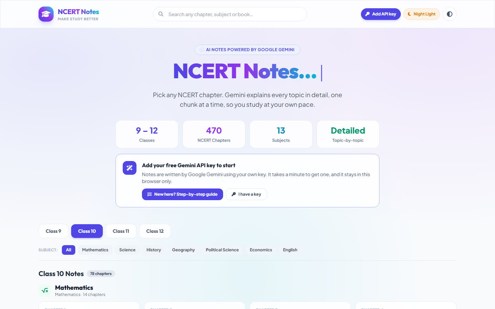

# NCERT Notes: AI chapter notes for Classes 9–12

Detailed, topic-by-topic study notes for every NCERT chapter, written by AI one chunk at a time: with the student's own Google Gemini key, or with a free built-in AI (NVIDIA Nemotron) after signing in with Google.

**Live site:** <https://cbsenotesgeneration.vercel.app>

[](./LICENSE)




## How it works

1. A student picks a chapter. If another student has already shared it, the notes open instantly, with no key and no sign-in.
2. Otherwise the AI writes it. Students either add their own free Gemini API key (a built-in guide shows how to get one from [Google AI Studio](https://aistudio.google.com/apikey)) or sign in with Google to use the free built-in AI, NVIDIA Nemotron, which runs on the site's server.
3. The AI first maps every topic in the chapter and splits it into 6–10 parts (3–6 for English). Part 1 appears as it is written, and a **Generate next chunk** button writes the next part, so students study at their own pace.
4. Every part is saved. Opening the chapter again never calls the AI twice.

## Features

- **All 470 chapters** of the current (rationalised) NCERT books for Classes 9–12. The 13 subjects are Mathematics, Science, Physics, Chemistry, Biology, History, Geography, Political Science, Economics, English, Accountancy, Business Studies and Computer Science.
- **Very detailed notes:**
  - NCERT definitions;
  - every formula with symbols and units, and step-by-step derivations;
  - worked examples, comparison tables and exam tips;
  - quick revision points and practice questions in each part.
- **Exam practice:** the last part of each chapter has a full summary plus MCQs and short- and long-answer questions in CBSE board pattern, with answers.
- **Proper maths and chemistry:** formulas and chemical equations are rendered with KaTeX and mhchem.
- **Google sign-in (optional):** notes are saved to the student's account with Supabase, so a chapter generated on a phone opens instantly on a laptop.
- **Reading tools:**
  - topic sidebar with progress, rewrite and reset;
  - text size control, dark mode and an eye-care night light;
  - Save as PDF.
- **Shared notes library:**
  - When a student shares a chapter, every other student can open it instantly, with no API call and no key needed.
  - Sharing is optional, either per chapter or automatic in **Settings**.
  - It's protected by database rules: only a more complete copy can replace a shared one, a complete chapter is never replaced, each account can newly share at most 25 chapters a day, and chapters reported by 3 students are hidden automatically.
- **Free built-in AI:** signed-in students without a working Gemini key get NVIDIA Nemotron through a Vercel server function. The NVIDIA keys never reach the browser, the server writes the prompts itself so it only produces NCERT notes, and usage limits are counted in the database (60 requests an hour and 200 a day per student, 3,000 a day in total).
- **Settings panel** for shared notes, account, API key and device storage.
- **Clear error messages** for a wrong key, rate limits and network problems, each with a retry button.
- **No build step:** plain HTML, CSS and JavaScript, plus one Vercel server function.


## Run locally

```bash
git clone https://github.com/legend0x01/cbsenotesgeneration.git
cd cbsenotesgeneration
python -m http.server 8000
```

Open <http://localhost:8000>, follow the guide to add a Gemini API key, and pick a chapter.
The free built-in AI needs the server function, so run `npx vercel dev` instead if you want to try it locally.

## Turn on Google sign-in and cloud-saved notes

This is optional. Without it, notes are saved in the browser only. Follow [SUPABASE_SETUP.md](SUPABASE_SETUP.md) to:

1. create a free Supabase project;
2. run [`supabase/schema.sql`](supabase/schema.sql), then [`supabase/shared_notes.sql`](supabase/shared_notes.sql) and [`supabase/free_ai.sql`](supabase/free_ai.sql);
3. turn on Google sign-in;
4. paste the project URL and anon key into [`js/config.js`](js/config.js).

## Free built-in AI (Vercel)

Set these in Vercel → Settings → Environment Variables:

| Variable | What it does |
|---|---|
| `NVIDIA_API_KEYS` | One or more NVIDIA API keys from [build.nvidia.com](https://build.nvidia.com), comma separated (required) |
| `NVIDIA_MODEL` | Model that writes the notes (default `nvidia/nemotron-3.5-super-vl-120b-a12b`) |
| `FREE_AI_HOURLY_LIMIT`, `FREE_AI_DAILY_LIMIT`, `FREE_AI_GLOBAL_DAILY_LIMIT` | Lower the usage limits (defaults 60, 200 and 3000; to raise them, edit `supabase/free_ai.sql`) |

## Project structure

```
index.html            Page layout, styles, reader, key dialog and get-started guide
js/config.js          Supabase URL and anon key (empty = sign-in turned off)
js/curriculum.js      Every NCERT chapter for Classes 9–12
js/gemini.js          Gemini REST client (key check, JSON outline, streamed notes)
js/prompts.js         Note-writing prompts, shared by the browser and the server
js/cloud.js           Supabase Google sign-in and per-student note storage
js/freeai.js          Browser client for the free built-in AI
js/app.js             Chapter browser, chunk-by-chunk reader, sharing, sync
api/generate.js       Vercel server function: free built-in AI (NVIDIA Nemotron)
supabase/schema.sql   Private notes table with Row Level Security
supabase/shared_notes.sql  Shared notes library, sharing/report functions and rules
supabase/free_ai.sql  Usage limits for the free built-in AI
privacy.html          Privacy Policy
terms.html            Terms of Service
404.html              Page shown for unknown links
```

## Privacy

- The Gemini API key is stored only in the student's browser and sent only to Google.
- The free built-in AI sends NVIDIA only the chapter and topic list, never a student's name, email or key.
- When a student signs in, their notes (never their key) are stored in Supabase, and Row Level Security lets each student read only their own notes.

## Disclaimer

Notes are AI-generated and can contain mistakes. Always check with your NCERT textbook. This project is not affiliated with NCERT or CBSE. Google's Gemini API terms require users to be 18 or older, so younger students should ask a parent or teacher to create the key.

## License

Released under the [MIT License](LICENSE).
