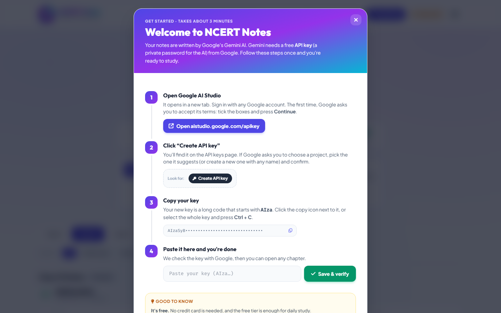

# NCERT Notes: AI chapter notes for Classes 9–12

Detailed, topic-by-topic study notes for every NCERT chapter, written by Google Gemini, one chunk at a time.

**Live site:** <https://cbsenotesgeneration.vercel.app>

[](./LICENSE)


## How it works

1. A student adds their own free Gemini API key. A built-in step-by-step guide shows how to get one from [Google AI Studio](https://aistudio.google.com/apikey).
2. They click any chapter. Gemini first maps every topic in the chapter and splits it into 6–10 parts (3–6 for English).
3. Part 1 appears as Gemini writes it. A **Generate next chunk** button then writes the next part, so students study at their own pace.
4. Every part is saved. Opening the chapter again never calls the API twice.

## Features

- **All 470 chapters** of the current (rationalised) NCERT books for Classes 9–12. The 13 subjects are Mathematics, Science, Physics, Chemistry, Biology, History, Geography, Political Science, Economics, English, Accountancy, Business Studies and Computer Science.
- **Very detailed notes:**
  - NCERT definitions;
  - every formula with symbols and units, and step-by-step derivations;
  - worked examples, comparison tables and exam tips;
  - quick revision points and practice questions in each part.
- **Exam practice:** the last part of each chapter has a full summary plus MCQs and short- and long-answer questions in CBSE board pattern, with answers.
- **Proper maths and chemistry:** formulas and chemical equations are rendered with KaTeX and mhchem.
- **Google sign-in (optional):** notes are saved to the student's account with Supabase, so a chapter generated on a phone opens instantly on a laptop.
- **Reading tools:**
  - topic sidebar with progress, rewrite and reset;
  - text size control, dark mode and an eye-care night light;
  - Save as PDF.
- **Shared notes library:**
  - When a student shares a chapter, every other student can open it instantly, with no API call and no key needed.
  - Sharing is optional, either per chapter or automatic in **Settings**.
  - It's protected by database rules: only more complete copies can replace a shared one, and chapters reported by 3 students are hidden automatically.
- **Settings panel** for shared notes, account, API key and device storage.
- **Clear error messages** for a wrong key, rate limits and network problems, each with a retry button.
- **No build step:** plain HTML, CSS and JavaScript.



## Run locally

```bash
git clone https://github.com/legend0x01/NotesNcert.git
cd NotesNcert
python -m http.server 8000
```

Open <http://localhost:8000>, follow the guide to add a Gemini API key, and pick a chapter.

## Turn on Google sign-in and cloud-saved notes

This is optional. Without it, notes are saved in the browser only. Follow [SUPABASE_SETUP.md](SUPABASE_SETUP.md) to:

1. create a free Supabase project;
2. run [`supabase/schema.sql`](supabase/schema.sql);
3. turn on Google sign-in;
4. paste the project URL and anon key into [`js/config.js`](js/config.js).

## Project structure

```
index.html            Page layout, styles, reader, key dialog and get-started guide
js/config.js          Supabase URL and anon key (empty = sign-in turned off)
js/curriculum.js      Every NCERT chapter for Classes 9–12
js/gemini.js          Gemini REST client (key check, JSON outline, streamed notes)
js/cloud.js           Supabase Google sign-in and per-student note storage
js/app.js             Chapter browser, prompts, chunk-by-chunk reader, sync
supabase/schema.sql   Private notes table with Row Level Security
supabase/shared_notes.sql  Shared notes library, sharing/report functions and rules
privacy.html          Privacy Policy
terms.html            Terms of Service
```

## Privacy

- The Gemini API key is stored only in the student's browser and sent only to Google.
- When a student signs in, their notes (never their key) are stored in Supabase, and Row Level Security lets each student read only their own notes.

## Disclaimer

Notes are AI-generated and can contain mistakes. Always check with your NCERT textbook. This project is not affiliated with NCERT or CBSE. Google's Gemini API terms require users to be 18 or older, so younger students should ask a parent or teacher to create the key.

## License

Released under the [MIT License](LICENSE).
